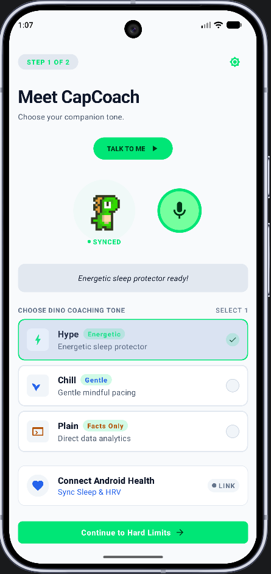
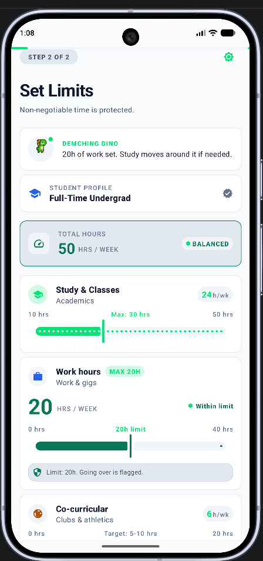
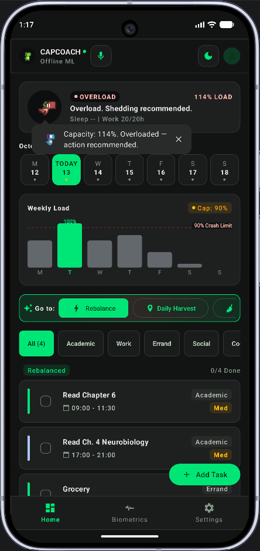
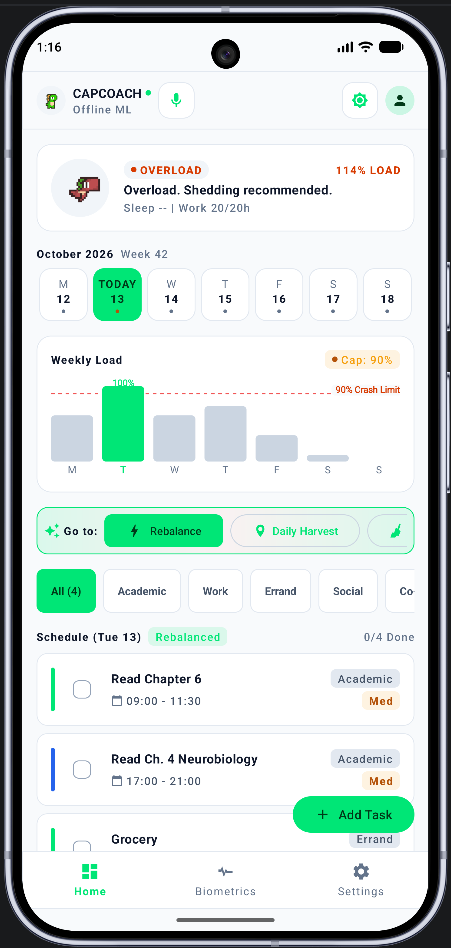
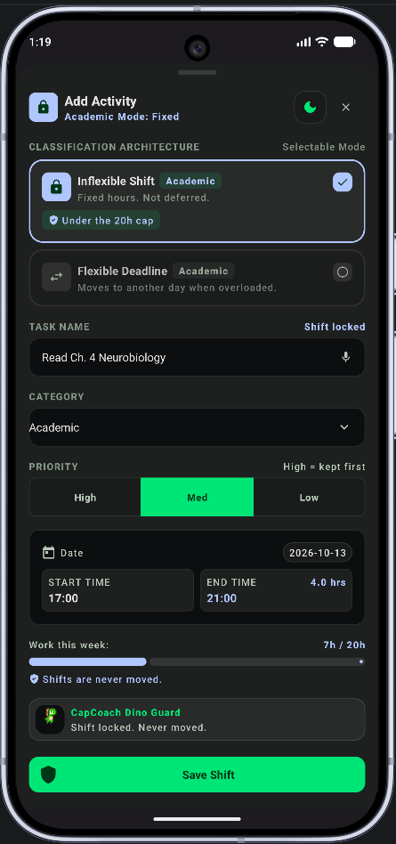
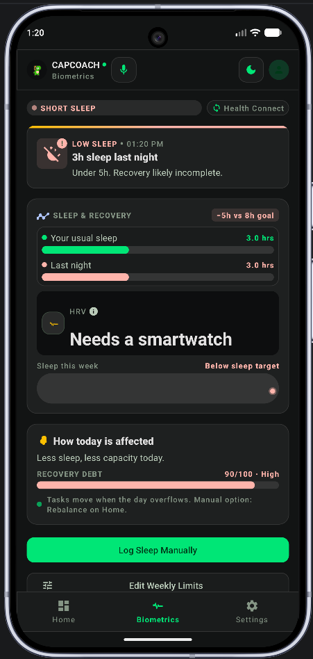
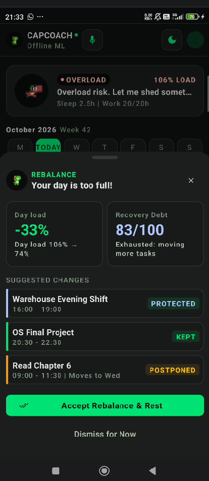
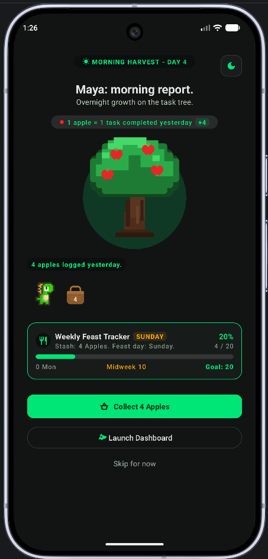
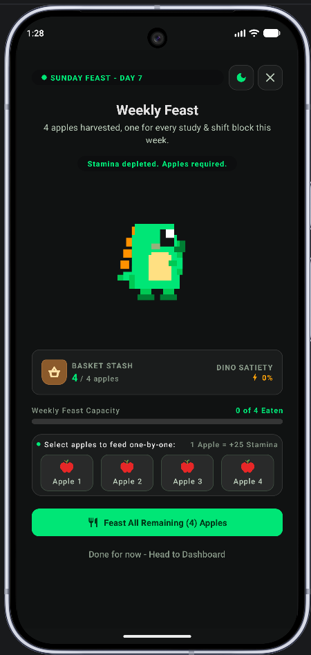
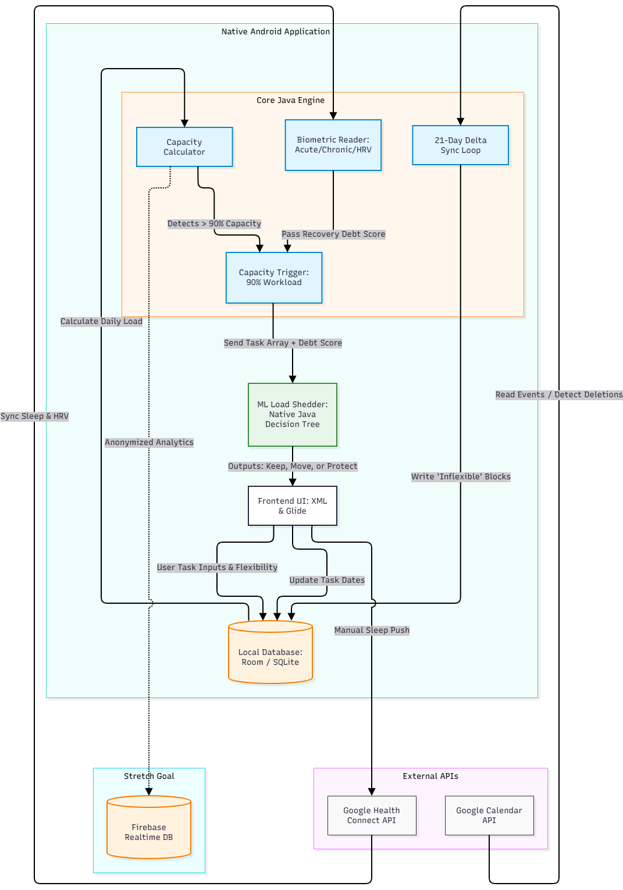

# CapCoach by All Purpose

**Team:** Lievaashini Thanasegaran, Dhanya Gotami K.D, Lee Jian Cheng, Wong Yan Wen  
 **Problem Statement:** Lifestyle Track: Beating the Burnout (Stress & Workload Manager)  
 **Video Presentation:** https://youtu.be/cX_QuVTY19g?si=78LXkAYxkxL6Fqsv 
 **Deployment link:** https://github.com/Lievaashini/All_Purpose-CodeNection/releases/download/Release-1.0.1-Beta/CapCoach-release-v1.0.1-Beta.apk
 **User guide (docs / pdf link):** https://docs.google.com/document/d/1GDeX0yO5My5Yo3n37yxzn_ye48-k9ARg4p0ShaqUYI4/edit?usp=sharing
 **Full Demo Video:** https://drive.google.com/file/d/17kQvXCNfSo7twA_7zrMztSPAu9b62it1/view?usp=drivesdk
 **Presentation Slides:** https://canva.link/af67hfyhan5ktfx

## **1. Project Overview**

### **One-Liner:** CapCoach is an automated workload rebalancer that predicts burnout before it hits by calculating your recovery debt against your real-time biodata.

**The Problem:** Academic burnout is a silent epidemic among working university students in Malaysia. Local clinical studies show that 56% of Malaysian undergraduates suffer from severe academic burnout, driven by a staggering 90.1% prevalence of poor sleep quality. This physiological toll is compounded by "work-school conflict." 

Current data reveals that 57.3% of students struggle to balance part-time employment with academic requirements, hitting a critical breaking point when work exceeds 20 hours a week. 

Existing market solutions like *MyPossibleSelf* or standard calendar apps fail these students as  they act as passive diaries that treat all time equally.

**Our Solution:** CapCoach is an automated, proactive burnout intervention engine. It uses local biometric data to predict exhaustion before it happens, and a lightweight, on-device Machine Learning classifier to actively reorganize a working student's schedule when they hit capacity.

**Key Features:**

- **Biometric Capacity Predictor (Health Connect):** Natively syncs with Android Health Connect to measure an advanced "Recovery Debt Score." Features a custom engine that weights Acute Sleep Deficit (last 24h), Chronic Exhaustion (7-day trailing average), and Heart Rate Variability (HRV) to mathematically forecast a 90% capacity breach. 
    
- **Proactive ML Load Shedder:** Automatically triages the student's to-do list using a local Machine Learning Decision Tree. It categorizes tasks into "Keep," "Move," and "Protect" by weighing flexible academic deadlines against inflexible work shifts. The Smart Assistant acts autonomously, automatically deploying the Triage UI the moment a user returns to their dashboard in an overloaded state.
    
- **Interactive Mascot & Gamification:** A minimal-typing, visual mascot (Green/Yellow/Red Dino states) keeps the tool accessible for cognitively fatigued users. An end-of-week gamification loop visualizes task completion as golden apples, allowing the Dino to feast and providing a visual sense of accomplishment. 
    
- **Frictionless 21-Day Delta Sync:** Natively links with Google Calendar via a custom 21-day bidirectional isolated sync loop. Automatically ingests unmovable commitments while filtering out "All-Day Event" layout bombs, locking external events down so they never conflict with user-edited flexible tasks. 

### **2. Design & Prototype**

**UI Prototype:** https://allpurposecapcoach.netlify.app/Prototype 

*(Please click on the above link to view the prototype, encouraged to view on phone since it's prepared in mobile view.)*

**Design System:**  
Fonts: Plus Jakarta Sans, Inter. Colors: Primary Blue #1D70B8, Green #107C41, Red #D83B01, Background #121820. Global App Bar features the Sun/Moon toggle. Bottom Nav is unified into [Home], [Biometrics], [+ Add Task], [Settings].

 Screen 1: Baseline Onboarding
   

 Screen 2: Unified "Home" Dashboard: 
     

 Screen 3: Add Activity Modal
  

 Screen 4: Crisis/Warning widget
    

 Screen 5: Burnout Intervention Pop-up 
 

 Screen 6: Interactivity : End-of-week "Feast Modal." The Dino is surrounded by apples representing the tasks successfully completed that week, which the Dino consumes. 
    

### **3. What Makes It Different**

| Feature | The CapCoach Innovation | Differentiation from Current Market |
| :---- | :---- | :---- |
| **Automated Triage (On-Device ML)** | Uses a local Decision Tree to evaluate flexible deadlines against inflexible work shifts to decide what can be safely postponed. | Generic apps force the stressed user to manually reschedule their own calendar. |
| **Biometric Prediction** | Pulls local Sleep Debt via Android Health Connect API to multiply capacity load and predict burnout 48 hours early. | Mental health apps rely entirely on subjective, manual journal entries. |
| **Zero-Cloud Privacy** | Biometric data and task prioritization happen entirely offline using Android Room and Native Java ML. | Competitors often sync sensitive user journal data to centralized cloud servers. |
| **B2B Monetization Model** | Designed as an enterprise wellness tool licensed by Universities to protect working-student retention and social equity. | Most apps use intrusive banner ads, which actively degrade the UX for a stressed student. |
| **Interactivity Layer**  | Empathy-driven visual mascot uses localized slang and an interactive gamification loop (apple feasting) for daily/weekly accomplishment.  | Standard trackers are clinical, robotic, and offer no empathetic connection to a stressed user.  |

### **4. Technical Architecture & Feasibility**

#### **Tech Stack**

- **Frontend UI:** Android Studio XML. Why: Provides native performance and allows seamless use of Glide for rendering pixel-art GIFs without heavy web-browser overhead. Uses a unified single Home Dashboard fragment.
- **Core Logic:** Native Java. Why: Robust Object-Oriented approach for building the Capacity Calculator math, 21-day Delta Sync loop, and managing local databases.
- **Local Database:** SQLite / Android Room. Why: Guarantees 100% privacy for biometric data and ensures the app is fully deployable without an internet connection.
- **Machine Learning:** Scikit-Learn (Python) & Native Java. Why: We trained a highly efficient Decision Tree classification model offline, stripped out heavy TFLite dependencies, and exported the logic as a pure native Java class (`LoadShedder.java`) for zero-latency, hallucination-free triage.
- **Cloud Database (Stretch):** Firebase Realtime DB. Why: Will be used strictly for anonymized B2B university analytics once local features are flawless.
- **API 1:** Google Health Connect (Bidirectional read/write for sleep and HRV).  
- **API 2:** Google Calendar API (Automatic commitment ingestion & ghost deletion tracking).

#### **System Architecture Diagram**

### **5. Market Research & Data References**

**Sleep Quality & Academic Burnout:** 
- 90.1% of Malaysian undergraduates experience poor sleep quality; 56.0% experience academic burnout. 

- Joanne Lim KE, Cheah KJ, Abdul Latif FA, Mohd Shahrin FI. Academic Burnout and Its Association with Sleep Quality, Physical Activity, and Social Media Addiction Among University Students in Perak, Malaysia: A Cross-Sectional Study . Makara J Health Res. 2025;29. https://scholarhub.ui.ac.id/cgi/viewcontent.cgi?article=1845&context=mjhr 
  
**Working Student Psychological Strain:** 
- Highlights severe psychological strain and dropout risks for Malaysian working students.  
    
- Yusmariaziani Yusri. (2021). Work-School Conflict, Academic Commitment and Life Satisfaction among Working University Students in Malaysia. Jurnal Psikologi Dan Kesihatan Sosial, 5(1), 8 –. https://doi.org/10.51200/jpks.v8i1.5608 

**The ML Logic Foundation (The 20-Hour Wall):** 
- Proves 57.3% struggle to balance work and school, establishing the >20-hour work threshold for critical academic strain.

- Saddique , F. (2026). Influence of part-time employment on grade point average and academic outcomes of university students. Social Sciences Spectrum, 5(1), 251–259. https://doi.org/10.71085/sss.05.01.481